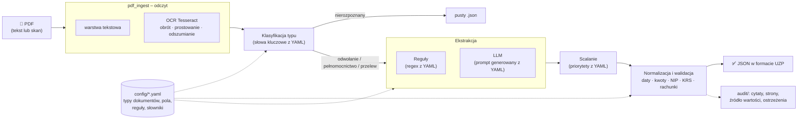

# ⚖️ Odwołania2json

**Automatyczna ekstrakcja danych z akt spraw odwoławczych KIO do kanonicznego modelu JSON.**

Aplikacja przyjmuje pliki PDF wchodzące w skład odwołania (pismo odwołania, pełnomocnictwo, potwierdzenie
przelewu wpisu), sama rozpoznaje typ każdego dokumentu **po jego treści** i zwraca jeden plik JSON na dokument
w formacie wymaganym przez UZP. Działa zarówno na PDF-ach z warstwą tekstową, jak i na skanach (OCR).

**Najważniejsze cechy**

- 📄 **Trzy typy dokumentów:** odwołanie, pełnomocnictwo, potwierdzenie przelewu. Dokument nierozpoznany
  (np. ogłoszenie, wyrok, broszura) daje pusty plik `.json`, zgodnie z wymaganiami UZP.
- 🧩 **Nowe typy i pola bez zmian w kodzie.** Każdy typ dokumentu to jeden plik YAML w `config/document_types/`.
  Można go też utworzyć w GUI.
- 🔍 **Transparentność.** Dla każdego pola zapisywany jest cytat źródłowy, numer strony i informacja, który
  ekstraktor dał wartość. Cytaty od LLM są sprawdzane, czy naprawdę występują w dokumencie.
- 🖨️ **Skany.** OCR z językiem polskim, automatyczne obracanie i prostowanie stron, usuwanie czarnych pól
  anonimizacji.
- 🖥️ **On-premise, bez GPU.** OCR działa lokalnie (Tesseract), a LLM jest wołany przez API.
- 🔓 **Wyłącznie open source**, w tym otwarto-źródłowy model językowy.

---

## Szybki start

**Wymagania:** Python **3.13+** oraz [Tesseract OCR](https://github.com/UB-Mannheim/tesseract/wiki) z językami
`pol` i `osd`:
- Windows: instalator UB-Mannheim, przy instalacji zaznacz *Polish*;
- macOS: `brew install tesseract tesseract-lang`;
- Linux: `sudo apt install tesseract-ocr tesseract-ocr-pol tesseract-ocr-osd`.

Sprawdzenie: `tesseract --list-langs` powinno pokazać `osd` i `pol`. Jeśli Tesseract nie jest w `PATH`,
ustaw `tesseract_cmd` w `config/ingest.yaml`.

| | Windows | macOS | Linux |
|---|---|---|---|
| **GUI w przeglądarce** | dwuklik `start.bat` | dwuklik `start.command` | `./start.sh` |
| **Tryb UZP: `input/` → `output/`** | `start.bat batch` | `./start.sh batch` | `./start.sh batch` |

Skrypty same tworzą środowisko `.venv`, instalują `requirements.txt` i uruchamiają aplikację
(GUI otwiera się pod http://localhost:8501).

**Tryb UZP:** włóż PDF-y do `input/` (mogą być w podfolderach, np. jeden folder na sprawę). Wyniki trafiają do
`output/` z tą samą strukturą i nazwami plików: `input/sprawa1/0003.pdf` → `output/sprawa1/0003.json`.

<details>
<summary>Uruchomienie ręczne (bez skryptów)</summary>

```bash
python -m venv .venv
.venv\Scripts\activate                 # macOS/Linux: source .venv/bin/activate
python -m pip install -r requirements.txt

python main.py                                   # input/ -> output/
python main.py -i input -o output --audit audit  # + cytaty źródłowe i ostrzeżenia
python main.py --file sciezka/do/pliku.pdf       # jeden plik, wynik na ekranie
python main.py --check-config                    # walidacja plików YAML
streamlit run app.py                             # GUI
```

Tryb demo GUI z danymi testowymi (bez OCR i LLM): zmienna środowiskowa `USE_MOCK=1`.
</details>

### Konfiguracja LLM

Utwórz plik `.env` w katalogu głównym (nie trafia do repozytorium):

```ini
LLM_BASE_URL=https://api.groq.com/openai/v1
LLM_API_KEY=twoj_klucz
LLM_MODEL=qwen/qwen3.8-27b
```

Bez tych zmiennych aplikacja działa na samych regułach. Ekstraktor LLM jest wtedy pomijany.

---

## Architektura



Każdy krok jest wymiennym komponentem wskazanym w `config/settings.yaml`, a cała wiedza o dokumentach
(pola, reguły, słowa kluczowe, opisy dla LLM) siedzi w plikach YAML. Kod Pythona nie zna nazw pól ani typów
dokumentów.

### Struktura projektu

```
config/
  settings.yaml           wybór komponentów (OCR, klasyfikator, ekstraktory), LLM, wyjście, ewaluacja
  ingest.yaml             ustawienia OCR i preprocessingu skanów
  document_types/*.yaml   1 plik = 1 typ dokumentu: schemat JSON, opisy, reguły, klasyfikacja
  dictionaries/*.yaml     słowniki (np. czynnosc_powod 1–12)
pdf_ingest/               PDF -> tekst: warstwa tekstowa albo OCR (Tesseract / RapidOCR),
                          prostowanie, obrót, odszumianie, usuwanie anonimizacji, cache wyników
odw2json/
  pipeline.py             orkiestracja: odczyt -> klasyfikacja -> ekstrakcja -> scalanie -> JSON
  ingest_adapter.py       łącznik pdf_ingest -> odw2json
  classify.py             klasyfikator regułowy (wagi słów kluczowych z YAML)
  extract_rules.py        ekstraktor regułowy sterowany YAML (regex / słownik / scope / split / findall)
  extract_llm.py          ekstraktor LLM (API zgodne z OpenAI), prompt i schemat generowane z YAML
  schema_builder.py       YAML -> JSON Schema, opis pól do promptu, pusty szablon
  normalize.py            normalizatory (daty, kwoty, NIP, REGON, KRS, rachunki, BZP, TED, nazwy…)
  validators.py           sumy kontrolne NIP/REGON/PESEL/IBAN (ostrzeżenia)
  postprocess.py          normalizacja, walidacja, pola wyliczane, kolejność pól z YAML
  config.py, document.py  ładowanie konfiguracji, wspólne struktury danych i interfejsy
main.py                   CLI (przetwarzanie wsadowe)
app.py, ui_bridge.py      interfejs Streamlit i jego łącznik z odw2json
evaluate.py               F1 per pole / typ / całość, raport błędów, porównanie z poprzednim runem
start.bat / start.sh / start.command   uruchomienie jednym kliknięciem
tests/                    testy (konfiguracja, reguły, OCR)
tools/                    narzędzia pomocnicze (benchmark OCR, generator skanów, demo API LLM)
docs/raport_jakosci.md    wyniki testów jakości
```

**Punkty rozszerzeń** (wymiana komponentu = zmiana jednej linii w `settings.yaml`):

| Komponent | Interfejs | Gdzie się wpina |
|---|---|---|
| OCR / ekstrakcja tekstu | `extract(path) -> ExtractedDocument` | `pipeline.text_extractor.class` |
| Klasyfikator | `classify(doc) -> ClassificationResult` | `pipeline.classifier.class` |
| Ekstraktor danych | `extract(doc, doc_type) -> ExtractionResult` | lista `pipeline.extractors` |

**Transparentność:** z opcją `--audit audit` dla każdego pliku powstaje `audit/<sprawa>/<plik>.json` z wynikiem
klasyfikacji (punkty i powody), cytatem źródłowym i numerem strony dla każdego pola, informacją, który ekstraktor
dał wartość, oraz ostrzeżeniami walidacji. Katalog `output/` zawiera wyłącznie JSON-y w formacie UZP.

---

## Model językowy (LLM)

| | |
|---|---|
| **Model** | `qwen/qwen3.8-27b` (Qwen, otwarte wagi) |
| **Dostęp** | API zgodne z OpenAI (`/chat/completions`), obecnie przez Groq |
| **Konfiguracja** | `.env` (`LLM_BASE_URL`, `LLM_API_KEY`, `LLM_MODEL`) oraz `config/settings.yaml` → `llm` |
| **Parametry** | `temperature: 0`, timeout 60 s, do 4 ponowień przy limicie API |

**Jak LLM współpracuje z regułami:**

1. **Podział pracy.** Pola o stałym formacie (daty, NIP, KRS, REGON, numery BZP/TED, rachunki, kwoty) biorą
   reguły, bo są szybkie i bezbłędne. Dane stron (Odwołujący, Zamawiający, mocodawcy, pełnomocnicy) bierze
   najpierw LLM (`prefer: [llm, rules]` w YAML), bo układ tych sekcji w prawdziwych pismach i skanach jest
   bardzo różny. Reguły zostają wtedy zapasem.
2. **Prompt i schemat JSON są generowane automatycznie z YAML** (opisy pól, typy, podpowiedzi `llm.hint`).
   Nowe pole w YAML od razu trafia do promptu.
3. **Odpowiedź LLM jest dopasowywana do struktury schematu** (np. gdy model „spłaszczy” zagnieżdżony obiekt)
   i przechodzi przez tę samą normalizację i walidację co reguły, więc model nie musi idealnie trzymać formatu.
4. **Odporność.** Przy limicie API (HTTP 429) i błędach serwera zapytanie jest ponawiane. Gdy API nie odpowiada,
   zostają wyniki reguł i aplikacja dalej zwraca poprawny JSON.

Dostawcę zmienia się w samym `.env`. Działa każdy serwer zgodny z API OpenAI, także lokalny
(np. Ollama, vLLM, llama.cpp server).

---

## Wyniki (zbiór treningowy UZP)

| Test | Wynik |
|---|---|
| Klasyfikacja tylko po treści (bez nazwy pliku), wszystkie PDF-y łącznie z negatywnymi | **196 / 196** |
| Ekstrakcja, same reguły, 180 dokumentów | **micro F1 0.993** (F1+null 0.994) |
| Ekstrakcja z LLM, próbka 5 spraw / 15 dokumentów | **micro F1 1.000** (bez LLM: 0.991) |
| Skan prawdziwego odwołania UZP | pewność OCR 0.93–0.95 |

| Same reguły | F1 (null ignorowane) | F1 + null |
|---|---|---|
| odwołanie | 1.000 | 1.000 |
| pełnomocnictwo | 0.977 | 0.983 |
| przelew | 0.992 | 0.992 |

Szczegóły są w [`docs/raport_jakosci.md`](docs/raport_jakosci.md). Dane treningowe są syntetyczne i bardzo
regularne, a zbiór testowy to realne sprawy (często skany). Na skanach reguły zawodzą głównie na danych stron
i tam przejmuje je LLM.

---

## Jak dodać nowe pole albo typ dokumentu (bez kodu)

Nowe pole w istniejącym typie dopisujemy do sekcji `schema` w YAML:

```yaml
      kwota_wpisu:
        type: number
        description: "Kwota wpisu od odwołania"        # trafia do promptu LLM i do UI
        rules: [{regex: 'Wpis\s+od\s+odwołania\s*:?\s*(?P<v>[\d ]+,\d{2})'}]
```

Nowy typ dokumentu to nowy plik, np. `config/document_types/faktura.yaml`:

```yaml
id: faktura
title: Faktura VAT
classification:
  min_score: 3
  keywords: [{pattern: 'Faktura\s+(?:VAT\s+)?nr', weight: 3}]
schema:
  numer: {type: string, rules: [{regex: 'Faktura nr (?P<v>\S+)'}]}
  kwota_brutto: number          # skrót: domyślna normalizacja kwoty
  data: date                    # skrót: każda polska data -> YYYY-MM-DD
```

Od razu działają: klasyfikacja, reguły, prompt i JSON Schema dla LLM, normalizacja, walidacja i ewaluacja.
Sprawdza to test `test_new_doc_type_without_code`. Poprawność konfiguracji sprawdza `python main.py --check-config`.

- **Typy pól:** `string, integer, number, date, enum (values: [...]), boolean_int, object (fields), list (items)`
- **Normalizatory:** `text, strip_quotes, smart_trailing_punct, company_name, person_name, email, lower, upper,
  digits, nip, regon, krs, pesel, account, int, bool_int, amount, date, bzp, ted, case_number, lookup,
  regex_replace, blank_to_null`
- **Pola wyliczane (`derive`):** `lookup` (np. opis z id w słowniku), `present` (1/0, gdy inne pole jest
  wypełnione), `null_if_single_in_list`, `copy`, `default`

---

## Ewaluacja i testy

```bash
python evaluate.py --gt ../hacknation-2026/dane --run --label moja_zmiana --compare last --errors bledy.csv --md raport.md
python -m pytest -q
```

- Listy (Odwołujący, Zamawiający, mocodawcy, pełnomocnicy) są dopasowywane algorytmem węgierskim, więc kolejność
  elementów nie obniża wyniku.
- TP/FP/FN liczone są per pole-liść, w dwóch wariantach: **F1** (para null–null pomijana) i **F1+null**
  (null–null = TP).
- Tryb `strict` (porównanie dokładne, domyślny) oraz `loose` (ignoruje wielkość liter i interpunkcję; pokazuje,
  ile punktów tracimy na samym formacie).
- Każdy run zapisuje się w `eval_runs/`, a `--compare last` pokazuje zmianę per pole.
- `--fail-under 0.95` zwraca kod 1, co pozwala użyć skryptu jako bramki w CI.
- Ewaluacja z wyłączonym LLM (nie zużywa limitu API): `LLM_MODEL= python evaluate.py ...`

---

## Wnioski z analizy danych

1. **PESEL w danych referencyjnych jest stringiem** (`"85071204278"`), choć `oczekiwane-json/pelnomocnictwo.json`
   pokazuje liczbę. Ustawiony jest `type: string`.
2. **Nie obcinamy kropek w nazwach firm** („S.A.”, „sp. z o.o.”, „sp. k.”). Zwykłe `rstrip('.')` kosztowało
   ~110 błędów. Służy do tego normalizator `company_name`.
3. `data` i `miejscowosc` pochodzą **tylko z linii nagłówka**. Gdy jej brak, referencja ma `null`, a data
   z podpisu na końcu pisma byłaby błędem.
4. `czynnosc_powod_id` wynika z zaskarżonej czynności Zamawiającego (pierwszej, jeśli jest ich kilka), a nie
   z tytułu zarzutu. `czynnosc_opis` jest zawsze brany ze słownika na podstawie id.
5. Numery BZP/TED/postępowania bierzemy tylko z nagłówka. W treści zarzutów bywają numery **innych** postępowań.
6. Rachunki zapisujemy bez `PL` i spacji (26 cyfr). Kwota to `float` (`200.0`).
7. Dokument nierozpoznany (np. ogłoszenie TED) daje **pusty plik** `.json`.
8. **Klasyfikacja nie może polegać na nazwie pliku.** Tytuły bywają pisane rozstrzelonymi literami
   („P E Ł N O M O C N I C T W O”), a banki różnie nazywają potwierdzenia („Potwierdzenie transakcji”,
   „Dowód wykonania przelewu”). Wszystkie te warianty są w YAML.
9. **Skany wprowadzają literówki** („Zamawicjący”, `@` czytane jako `(O`). Reguły dla etykiet i e-maili są
   na nie odporne.
